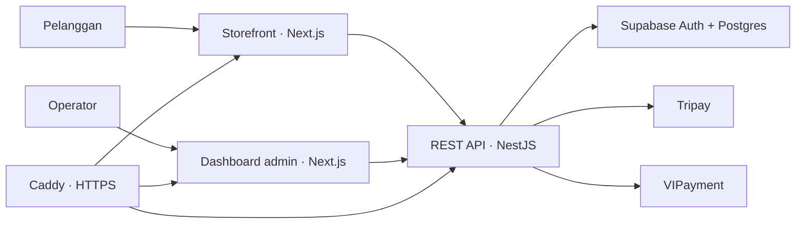

# Anres Store

**Anres Store adalah toko online untuk kebutuhan digital sehari-hari.**

Lihat [profil perusahaan](docs/business/company-profile.md), [pedoman bahasa](docs/business/brand-voice.md), dan [alur layanan dan bantuan pelanggan](docs/business/service-operations.md).

Anres Store adalah proyek full-stack berbasis TypeScript untuk menjelajahi katalog produk digital, mengelola akun dan pesanan, serta menjalankan alur pembayaran dan pemenuhan produk. Arsitektur monorepo ini memisahkan aplikasi pelanggan, panel admin, dan API agar tiap bagian dapat dikembangkan dan dioperasikan dengan tanggung jawab yang jelas.

> Status integrasi pembayaran, katalog, dan fulfillment mengikuti konfigurasi provider serta lingkungan yang digunakan. Transaksi produksi memerlukan kredensial dan verifikasi operasional.

## Fitur utama

- **Storefront pelanggan** — katalog game, prabayar, layanan digital, dan produk premium; keranjang, akun, pesanan, invoice, serta bantuan.
- **Dashboard operasional** — pengelolaan katalog, promosi, transaksi, refund, dan dukungan dengan akses admin yang diverifikasi server.
- **API transaksi** — REST API NestJS untuk validasi katalog dan harga, autentikasi, checkout, pembayaran, pemenuhan pesanan, serta dukungan.
- **Integrasi provider** — Tripay untuk invoice pembayaran dan VIPayment untuk item serta pemenuhan layanan yang didukung.
- **Fondasi keamanan** — Supabase Auth dan Postgres, kontrol akses berbasis role, pemeriksaan signature callback, dan penanganan status transaksi.
- **Panduan operasional** — dokumentasi arsitektur, keamanan, migrasi database, deployment VPS, dan checklist rilis.

## Arsitektur



API memvalidasi harga dan detail pesanan di sisi server. Status pembayaran, fulfillment, dan refund dikelola terpisah; callback provider diverifikasi sebelum mengubah status transaksi. Nilai mata uang disimpan sebagai bilangan bulat rupiah dan timestamp menggunakan UTC.

## Teknologi

| Area | Teknologi |
| --- | --- |
| Storefront dan admin | Next.js, React, TypeScript |
| API | NestJS, TypeScript |
| Data dan autentikasi | Supabase Auth, PostgreSQL |
| Pembayaran dan fulfillment | Tripay, VIPayment |
| UI bersama | React, Tailwind CSS, Radix UI |
| Deployment | Docker Compose, Caddy |

## Struktur repository

| Direktori | Isi |
| --- | --- |
| `apps/web` | Storefront dan pengalaman pelanggan |
| `apps/admin` | Dashboard operasional |
| `apps/api` | REST API dan integrasi provider |
| `packages/` | UI, kontrak TypeScript, konfigurasi, dan klien Supabase bersama |
| `supabase/` | Migrasi skema, template autentikasi, dan pengujian SQL |
| `infra/` | Dockerfile, Compose, dan konfigurasi Caddy |
| `scripts/` | Utilitas database, domain lokal, dan rilis |
| `docs/` | Dokumentasi arsitektur, keamanan, API, dan operasi |

## Menjalankan lokal

### Prasyarat

- Node.js `>=22.18`
- npm `>=10`
- Supabase lokal/remote untuk fitur yang menggunakan autentikasi dan database

### Instalasi

```powershell
npm ci
Copy-Item apps/web/.env.example apps/web/.env.local
Copy-Item apps/api/.env.example apps/api/.env
npm run dev
```

> Atur variabel lingkungan sesuai layanan yang ingin dijalankan. Contoh env hanya untuk konfigurasi lokal; jangan masukkan secret produksi ke repository atau variabel `NEXT_PUBLIC_*`.

Secara default aplikasi berjalan pada alamat berikut:

| Aplikasi | URL lokal |
| --- | --- |
| Storefront | `http://localhost:3000` |
| Dashboard admin | `http://localhost:3001` |
| API | `http://localhost:4000` |

Jalankan service secara terpisah bila diperlukan dengan `npm run dev:web`, `npm run dev:admin`, atau `npm run dev:api`.

## Perintah proyek

```sh
npm run typecheck   # Pemeriksaan tipe seluruh workspace
npm test            # Pengujian workspace
npm run test:web    # Pengujian unit utilitas storefront
npm run test:db     # Pemeriksaan migrasi database
npm run build       # Build aplikasi dan paket
```

> Pengujian database memerlukan Supabase CLI dan layanan lokalnya. Skrip lain yang tersedia termasuk `npm run db:start`, `npm run db:reset`, dan `npm run db:test`.

## Deployment dan dokumentasi

Konfigurasi produksi menggunakan Docker Compose dan Caddy. Sebelum deployment, siapkan secret di server, domain dan TLS, backup database, konfigurasi provider, serta validasi transaksi end-to-end.

- [Indeks dokumentasi](docs/README.md)
- [Ikhtisar arsitektur](docs/architecture/overview.md)
- [Panduan deployment VPS](docs/operations/vps-deployment.md)
- [Checklist rilis](docs/operations/release-checklist.md)
- [Catatan keamanan](docs/security/README.md)
- [Peta endpoint API](docs/api/README.md)
- [Panduan kontribusi](CONTRIBUTING.md)

## Catatan lisensi dan aset

Repository ini belum menetapkan lisensi open source. Kode dan aset tidak otomatis bebas digunakan ulang. Nama produk dan artwork pihak ketiga tetap menjadi milik pemegang hak masing-masing; lihat catatan aset di `apps/web/public/brand/`.
