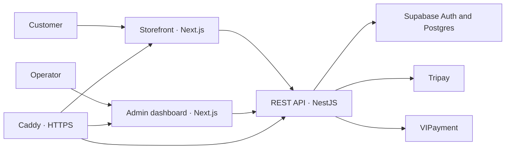

# Anres Store

Anres Store is a digital services storefront built as a TypeScript monorepo. It includes a customer storefront, an operations dashboard, and a server API for catalog, payment, account, and order workflows.

## Product capabilities

- Browse game top-ups, prepaid services, social media services, task services, and premium app offers.
- Keep catalog pricing and order validation on the server.
- Create payment invoices through Tripay and fulfill supported supplier orders through VIPayment.
- Manage products, promotions, support, and order operations from a role-protected admin dashboard.
- Use Supabase Auth and Postgres for customer identity and application data.

Availability, prices, payment channels, and fulfillment rules depend on the configured providers and database state.

## Architecture



## Repository layout

| Path | Purpose |
| --- | --- |
| `apps/web` | Customer storefront |
| `apps/admin` | Operations dashboard |
| `apps/api` | REST API and provider integrations |
| `packages` | Shared UI, contracts, configuration, and Supabase clients |
| `infra` | Docker images, production Compose, and Caddy configuration |
| `supabase` | Database migrations, templates, and SQL checks |
| `scripts` | Release, environment, catalog, and database utilities |
| `docs` | Architecture, security, operations, and deployment guides |

## Local development

Requirements: Node.js `>=22.18`, npm `>=10`.

```powershell
npm ci
Copy-Item apps/web/.env.example apps/web/.env.local
Copy-Item apps/api/.env.example apps/api/.env
npm run dev
```

Configure local Supabase and provider settings in the app environment files as needed. Keep production credentials on the server; never copy them into `NEXT_PUBLIC_*` variables or commit environment files.

The storefront runs on port `3000`, the admin dashboard on `3001`, and the API on `4000`.

## Quality checks

```sh
npm run typecheck
npm test
npm run test:web
npm run test:db
npm run build
```

Database checks require the Supabase CLI and its local services. CI runs type checks, application tests, database tests, and builds on Node.js 24.

## Production deployment

Production uses Docker Compose and Caddy. Browse the [documentation index](docs/README.md), start with the [VPS deployment runbook](docs/operations/vps-deployment.md), review the [release checklist](docs/operations/release-checklist.md), and consult the [readiness audit](docs/operations/vps-readiness-audit.md). The API environment file is created on the server from `infra/api.env.example`; it is intentionally not included in the repository.

The repository contains deployment configuration, but a production launch still requires environment-specific secrets, verified database migrations, DNS and TLS, backups, provider allowlisting, and end-to-end transaction checks.

## Assets and license

Asset source notes are kept in `apps/web/public/brand/README.md` and `apps/web/public/brand/items/README.md`. Product names and third-party artwork remain the property of their respective owners. This repository does not currently grant an open-source license; obtain permission before reusing its code or assets.
